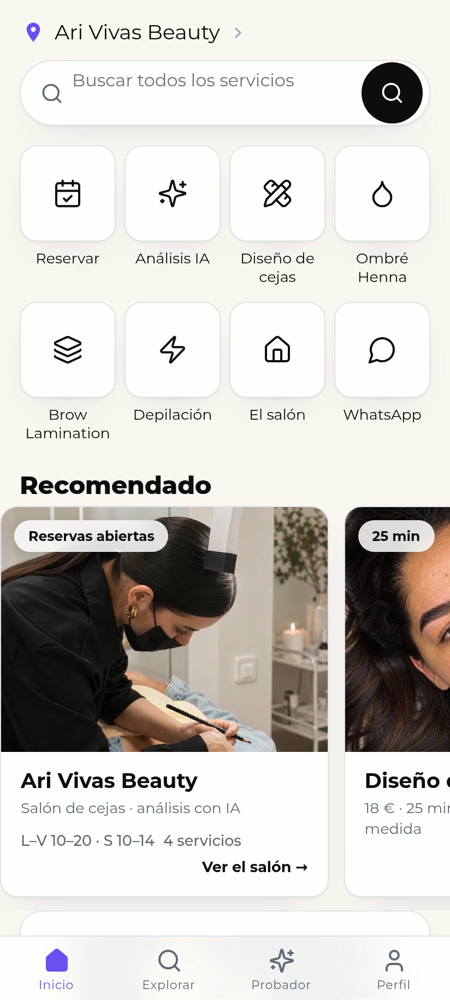
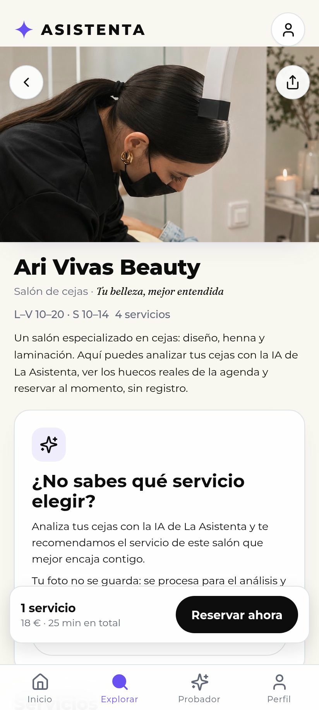
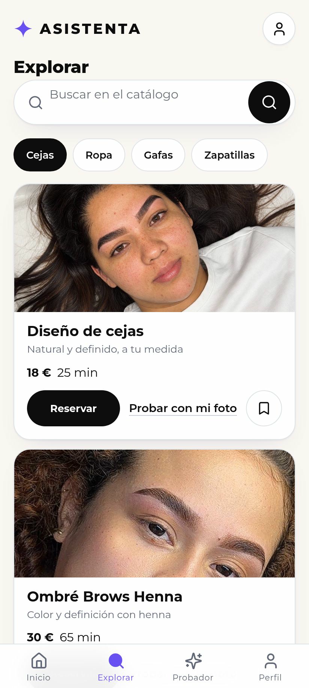
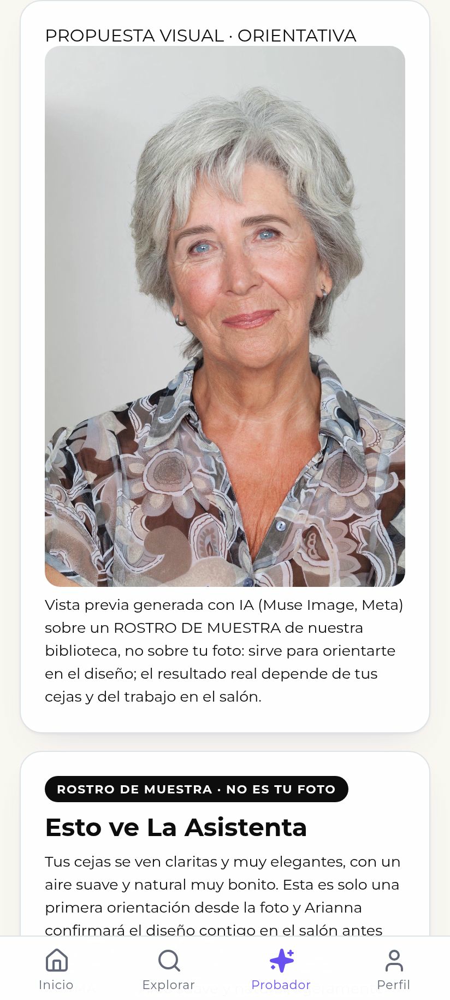
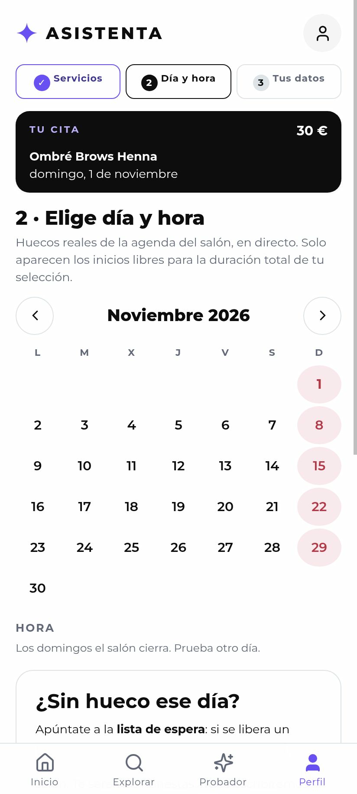
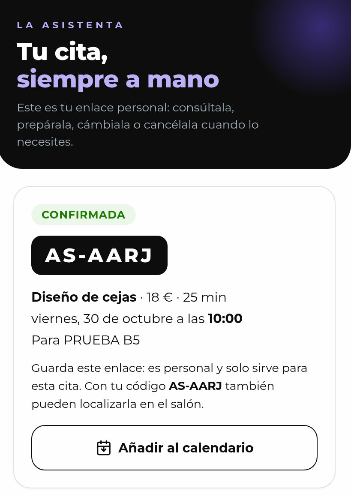
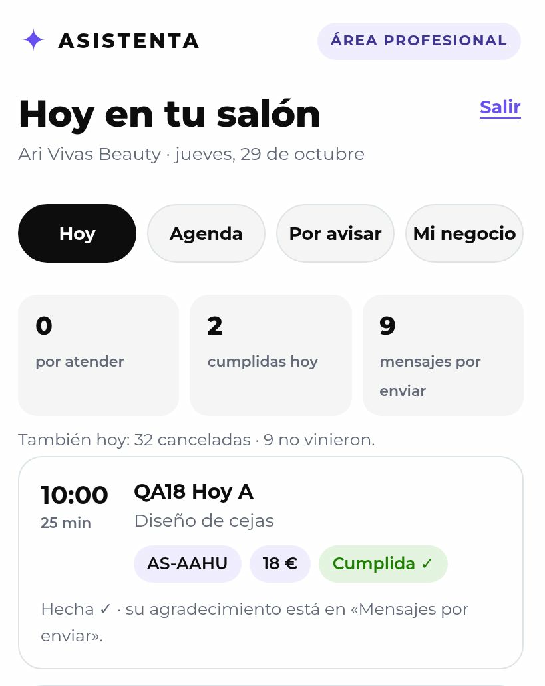
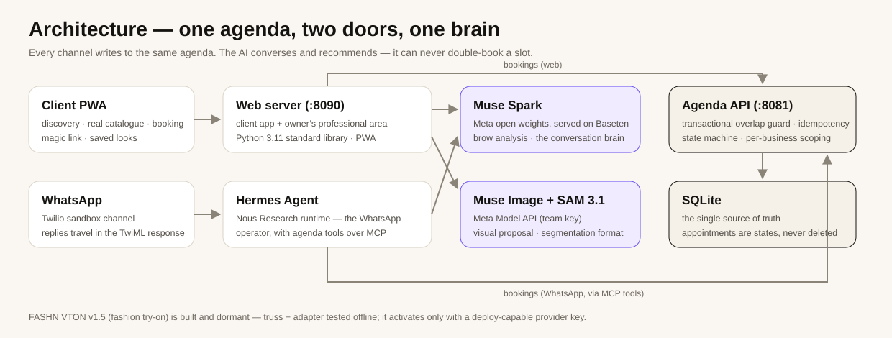

# La Asistenta

**A modular platform for AI-assisted booking and commerce for local businesses** — built for the Meta × Cerebral Valley hackathon, and running today with a real pilot business: **Ari Vivas Beauty**, a brow salon in Madrid ([arivivasbeauty.com/reserva-tu-experiencia](https://arivivasbeauty.com/reserva-tu-experiencia)).

A client discovers the salon, gets an AI brow analysis from a photo, sees **real** availability and books into the salon's **real** agenda — from a mobile web app or over WhatsApp, where an AI operator (Hermes) answers, recommends from the real price list and confirms the booking. The owner runs her day from a professional area: today's appointments, a 7-day agenda, a waitlist with one-tap WhatsApp follow-up, and a measured booking funnel.

> **Live demo:** https://8090-agqyfjnmnvcrrnfraerzrpu5ye.instabox.tech
> The demo runs on a free-tier machine that pauses after 30 idle minutes; it is woken up for judging sessions. Everything below is reproducible from this repository. The 3-minute demo video is part of the hackathon submission package (see [`ENTREGA_HACKATHON.md`](ENTREGA_HACKATHON.md)).

## The product, screen by screen

<table>
<tr>
<td width="50%"><br><em><strong>Home.</strong> The salon up front, a working search over the real catalogue, the module shelf and the Recommended carousel.</em></td>
<td width="50%"><br><em><strong>The salon's own page.</strong> Its real photo, its real hours (Mon–Fri 10–20 · Sat 10–14) and the entry to the AI analysis.</em></td>
</tr>
<tr>
<td width="50%"><br><em><strong>Explore.</strong> The real catalogue with real prices (Brow Design €18 · Ombré Brows Henna €30). The fashion, glasses and footwear modules sit honestly at “coming soon”.</em></td>
<td width="50%"><br><em><strong>The analysis.</strong> Muse Image's visual proposal first and large, labelled as an orientative preview — here generated on a sample face from the built-in library, and the screen says so (“sample face · not your photo”). Muse Spark's written orientation follows below.</em></td>
</tr>
<tr>
<td width="50%"><br><em><strong>Booking.</strong> Real availability computed from the salon's agenda: Sundays closed, and a waitlist offer when a day has no room.</em></td>
<td width="50%"><br><em><strong>Her appointment, always at hand.</strong> The personal magic-link page: the confirmed booking, its code and the two prep questions (a QA test booking — the personal token itself is never displayed).</em></td>
</tr>
<tr>
<td width="50%"><br><em><strong>The owner's professional area.</strong> Today at a glance: counters, one-tap states and the day's appointments (QA test entries).</em></td>
<td width="50%"></td>
</tr>
</table>

> **About these screenshots.** They are real captures of the production app at 412×915, taken during the project's QA passes (29 Oct – 4 Nov 2026) — not mock-ups. Two of them (magic link, professional area) predate the final warm visual polish (v34); the flows are unchanged. No real client data appears anywhere: the bookings shown are QA test entries, and the analysis shown uses the product's own sample-face library. Because this repository's history is published as text snapshots, each capture is stored as an SVG file whose payload is the capture itself (JPEG), so what you see is byte-identical to the original screenshot.

---

## Why it is built this way

Booking reliability outranks AI features. The agenda is the source of truth: every write goes through a transactional overlap guard, idempotency keys and a state machine that never deletes an appointment (cancellations are states, not erasures). AI is layered on top of that foundation — it recommends and converses, but it can never double-book a slot.

## Architecture



- **Two doors, one agenda.** The web app and the WhatsApp operator read and write the *same* agenda through the *same* guarded API — a booking made in chat appears in the owner's area instantly, and vice versa.
- **The AI never writes on its own word.** On WhatsApp, the operator shows a closed summary (service, day, time, price, name) and only writes after the client's explicit confirmation; in the web analysis, the recommendation is labelled as orientation and the salon confirms the design in person.
- **Photos are processed in memory and discarded.** Nothing about the analysis photo is stored; saved looks keep only the generated proposal the client chose to keep.

## The Meta stack

| Piece | Role |
|---|---|
| **Muse Spark** (`meta-models/muse-spark-open-1026`, Meta's open-weights model, served on Baseten) | The brain: brow-photo analysis and service recommendation in the web app (asynchronous, with honest progress polling), and the conversational operator behind WhatsApp. Measured in the activation closing pass: Spark analysis 12.8 s, full flow 28.7 s end-to-end in the UI |
| **Hermes Agent** (Nous Research) | The operator runtime: a WhatsApp receptionist with the salon's real services, prices and rules, tool access to the agenda via MCP, and human hand-off when a request falls outside the catalogue |
| **Muse Image + SAM 3.1** (Meta Model API) | Live since 30 Oct 2026, with the founder's team key verified against the real API and the $150 hackathon credit confirmed in Billing. The analysis returns a real generated visual proposal, shown first in the result card with its “orientation only” note; SAM 3.1's real response format (bounding-box + mask tokens over the Responses surface) is confirmed and parsed by our provider. Benchmark H1 over the authorized stock set: **12/12 proposals · identity preservation 5.0/5 · change confinement 5.0/5 · quality 4.33/5 · edit latency p50 16.1 s** ([`BENCHMARK_H1.md`](BENCHMARK_H1.md)) |
| **FASHN VTON v1.5** (Apache 2.0) | Chosen engine for the future fashion try-on module after a licence-first model survey ([`MODELOS_TRYON.md`](MODELOS_TRYON.md) — IDM-VTON and CatVTON were rejected on licence terms). Truss + adapter are built and tested offline; deployment waits on an inference-provider key with deploy permissions |

## What is live today (pilot: Ari Vivas Beauty)

- **Client PWA** (installable, offline shell, Spanish UI): discovery home driven by a central module registry (`web/modulos.json`), real service catalogue, salon page with the salon's real photos and TikTok videos, and literal client reviews.
- **Booking engine**: service packs in one appointment (prices/durations summed from the real list), month calendar + slot list, real availability, confirmation with a booking code (`AS-XXXX`) and a **magic link** (`/cita/<token>`, SHA-256 hashed at rest) to view, prep, reschedule or cancel. Real `.ics` download.
- **AI brow analysis**: consent → photo → async analysis by Muse Spark → a Muse Image visual proposal → recommended service → book it, without an account. Photos are processed in memory and discarded. Clients who prefer not to use their own photo can pick a **sample face from a built-in library** — the same real engine runs, and the result is sealed on screen as a sample, never passed off as their face.
- **WhatsApp channel**: Twilio sandbox webhook; replies travel in the TwiML response (the trial tier rejects free-form API sends). Hermes holds the conversation and writes to the same agenda.
- **Professional area** (`/profesional`, per-business key, 8 h session, rate-limited per visitor): Today with one-tap state changes (done / no-show / cancel), 7-day agenda with real free intervals, waitlist (`por_avisar`) with wa.me follow-up, an outbox, and the real funnel metrics.
- **Real data only**: the pilot's services are its public ones — Ombré Brows Henna €30 · Brow Lamination €45 · Brow Design €18 · Quick Waxing (ask) — Mon–Fri 10–20, Sat 10–14.

## Measured reliability (not claimed — measured)

From [`MEDICIONES.md`](MEDICIONES.md), reproducible with `agenda/mediciones.py` against the running services (localhost, 4 vCPU / 8 GiB):

| Measurement | Result |
|---|---|
| Health check (agenda API) | p50 **0.3 ms** |
| Availability query (web → API) | p50 **2.7 ms** |
| Create booking (with overlap guard) | p50 **1.3 ms** |
| Burst: 20× simultaneous availability reads | 20× 200, no errors |
| Burst: 5× simultaneous POSTs to the **same slot** | **1× 201 + 4× 409 in ~10 ms** — exactly one winner |

And on submission day (4 Nov 2026), the full validation swarm — kept as a repeatable flow in the project log ([`ESTADO_PROYECTO.md`](ESTADO_PROYECTO.md) §§82–83):

- **19 clients book at once**: the 6 who collide on the same slot produce exactly **1× 201 + 5× 409**; the other 13 all book (**13× 201**); a SQL audit finds **0 overlaps**. A transport finding under burst (TCP resets before reaching the app, traced to the server's default listen backlog of 5) was fixed by raising the backlog to 128 — after the fix, **4/4 bursts arrived complete (19/19, 0 resets)** and the full flow closed with a clean verdict.
- **10 clients run the full photo flow at once** (Spark analysis + Muse Image proposal each): **10/10 in 35.9 s wall** (median ≈29 s per client), 21 provider calls, **0 errors**, $0.10 of Meta credit.
- **Test batteries, all green against the real machine — 132/132**: web **33/33** · professional area **25/25** · agenda guard **11/11** · booking mechanics **23/23** · multi-business isolation **22/22** · try-on + Meta provider adapters **18/18** (offline). Plus click-through QA at 412×915 on every screen (QA16–QA26).
- **No double-booking, transactionally**: overlap check + insert in a single `BEGIN IMMEDIATE` transaction (also for reschedules).
- **Idempotent creation**: `POST /citas` accepts `Idempotency-Key` — same key + same body returns the original booking (200), same key + different body is rejected (422).
- **Cancellation guard**: a completed appointment can no longer be cancelled from any surface (409 “already done”); the guard lives in the agenda and covers web, magic link, professional area and the WhatsApp/MCP path.
- **Abuse limits are per visitor**: the rate-limit buckets (analysis, booking, professional login) key on the real visitor behind the proxy, verified on the public URL — one visitor filling their bucket never blocks another.
- **Honest scale note**: this shape comfortably serves one business and, on the same box, dozens of small ones. We do **not** claim it supports millions: that would need a served database, non-pausing machines, more workers — and fresh measurements at each step ([`MEDICIONES.md`](MEDICIONES.md) lists exactly what and why).

## Module map (the registry is the product's spine)

The UI renders from `web/modulos.json`; activating a module is a configuration change, not a code change — demonstrated in QA by flipping a module's state in a test instance.

| Module | State | Notes |
|---|---|---|
| **Beauty & booking** (`belleza`) | ✅ **Active** | The pilot above: catalogue, availability, booking, AI analysis, WhatsApp |
| **Fashion try-on** (`moda_probador`) | 🔜 Coming soon | Interfaces defined; FASHN VTON truss + adapter built and dormant; no catalogue or engine until verified with real products |
| **Glasses & accessories** (`gafas_accesorios`) | 🔜 Coming soon | Research done (no serious indie API exists; the pragmatic route is reference-based editing, labelled as an approximation) |
| **Footwear** (`calzado`) | 🔜 Coming soon | Reserved in the registry; engine research pending the fashion module |

“Coming soon” screens are honest by design: they explain what is being prepared and show no fake products, prices or previews.

## Documentation map

**Start here**

- [`ESTADO_PROYECTO.md`](ESTADO_PROYECTO.md) — the full project log (Spanish): every build, verification and decision, §§1–83.
- [`ENTREGA_HACKATHON.md`](ENTREGA_HACKATHON.md) — the submission package: the exact form copy, the demo-video script with per-shot provenance, and the honesty notes.
- [`ENSAYO_Y_DEMO.md`](ENSAYO_Y_DEMO.md) — the rehearsal & demo runbook, including the channel rules that must not be reverted.

**Evidence**

- [`MEDICIONES.md`](MEDICIONES.md) — measurement method and raw results behind every figure above.
- [`BENCHMARK_H1.md`](BENCHMARK_H1.md) + [`h1/resultados/`](h1/resultados) — the Muse Image benchmark: protocol, set, outputs and scores.
- [`ACTIVACION_META.md`](ACTIVACION_META.md) — how the Meta Model API key was provisioned and verified against the real API.
- [`PRUEBAS_ROBUSTEZ.md`](PRUEBAS_ROBUSTEZ.md) — robustness passes over the booking core.

**Design & decisions**

- [`ESPEC_REFERENCIA.md`](ESPEC_REFERENCIA.md) — the UX spec the client app is built against.
- [`DIAGNOSTICO_UX_MUSA.md`](DIAGNOSTICO_UX_MUSA.md) + [`AUDITORIA_ORDEN_MAESTRA.md`](AUDITORIA_ORDEN_MAESTRA.md) — the redesign diagnostics and the audit against the founder's master order.
- [`MODELOS_TRYON.md`](MODELOS_TRYON.md) + [`probador/INTERFACES.md`](probador/INTERFACES.md) — the licence-first try-on model survey and the dormant try-on contracts.
- [`GUION_DEMO.md`](GUION_DEMO.md) — the original demo script, minute by minute.

**Operations**

- [`HERMES_SETUP.md`](HERMES_SETUP.md) — the operator runtime setup.
- [`MIGRACION_INSTABOX.md`](MIGRACION_INSTABOX.md) — the hosting migration record.
- [`RUTA_C_TWILIO.md`](RUTA_C_TWILIO.md) — how the WhatsApp channel was made to work on a trial account.
- [`AUDITORIA_PUBLICACION.md`](AUDITORIA_PUBLICACION.md) — the pre-publication audit of this repository.

## Repository map

```
web/          Client PWA + professional area (stdlib Python server, port 8090)
  index.html    The whole client experience in one file
  cita.html     Magic-link appointment page
  profesional.html  Owner's area (served by web_server.py under /profesional)
  modulos.json  Central module registry — the UI renders from it
  qa*/          Click-through QA scripts (CDP, 412×915) per iteration
agenda/       Booking core (API on 8081, MCP server for Hermes, CLI)
  agenda_api.py   REST API: availability, bookings, waitlist, funnel, outbox
  agenda_comun.py Shared core: overlap guard, state machine, negocio_id scoping
  mcp_agenda.py   MCP tools the WhatsApp operator uses
  pruebas_*.py    Batteries: web 33/33 · professional 25/25 · guard 11/11 ·
                  mechanics 23/23 · phase-2 22/22 (132/132 in total)
whatsapp/     Twilio webhook → Hermes (replies via TwiML)
probador/     Try-on contracts, FASHN VTON truss + Baseten adapter (dormant)
app/          Android shell (Capacitor + a manual build) for the owner
h1/           Muse Image benchmark: set, protocol outputs and results
docs/img/     Product captures and the architecture diagram used in this README
*.md          The documentation map above — design, evidence and the full log
```

## Run it

Requirements: Python 3.11+ (stdlib only for web + agenda), a Baseten API key for Muse Spark, a Twilio sandbox for WhatsApp, Hermes Agent for the operator. Secrets live in `.env` files that are **never** in this repo (see the `.env.example` files); the agenda token is read from the environment only.

```bash
# 1 · Booking core (port 8081, localhost only)
AGENDA_API_TOKEN=<token> python3 agenda/agenda_api.py

# 2 · Client web + professional area (port 8090)
AGENDA_API_TOKEN=<token> BASETEN_API_KEY=<key> python3 web/web_server.py

# 3 · WhatsApp webhook (port 8080) — point the Twilio sandbox webhook here
python3 whatsapp/webhook.py   # replies are returned as TwiML

# Or all of it, idempotently, the way production does:
bash arrancar.instabox.sh
```

Verify any running instance with the batteries: `agenda/pruebas_api_guarda.py`, `agenda/pruebas_mecanicas.py`, `agenda/pruebas_fase2.py` (spins a throwaway instance on a copy of the DB) and `web/pruebas_web.py`.

## Privacy & honesty rules baked in

- Client photos for analysis are processed in memory and discarded; nothing is stored.
- No fake data anywhere: no invented reviews, ratings, prices or availability — and coming-soon modules show no simulated results.
- Test appointments created by the QA batteries are always left **cancelled**, never deleted; the pilot's agenda contains no live test data.
- Sample faces are stock photos, labelled as samples everywhere they appear — in the product and in this README.

## License

MIT — © 2026 Lee Renteria (Blackleets). Built during the Meta × Cerebral Valley hackathon (27 Oct – 4 Nov 2026).

---

*Documentación y registro de decisiones en español en los `.md` de la raíz (`ESTADO_PROYECTO.md` es el diario completo del proyecto).*
